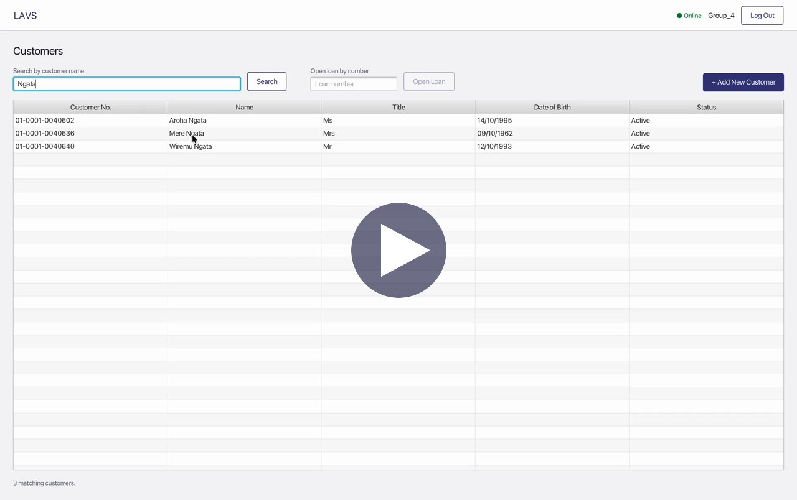
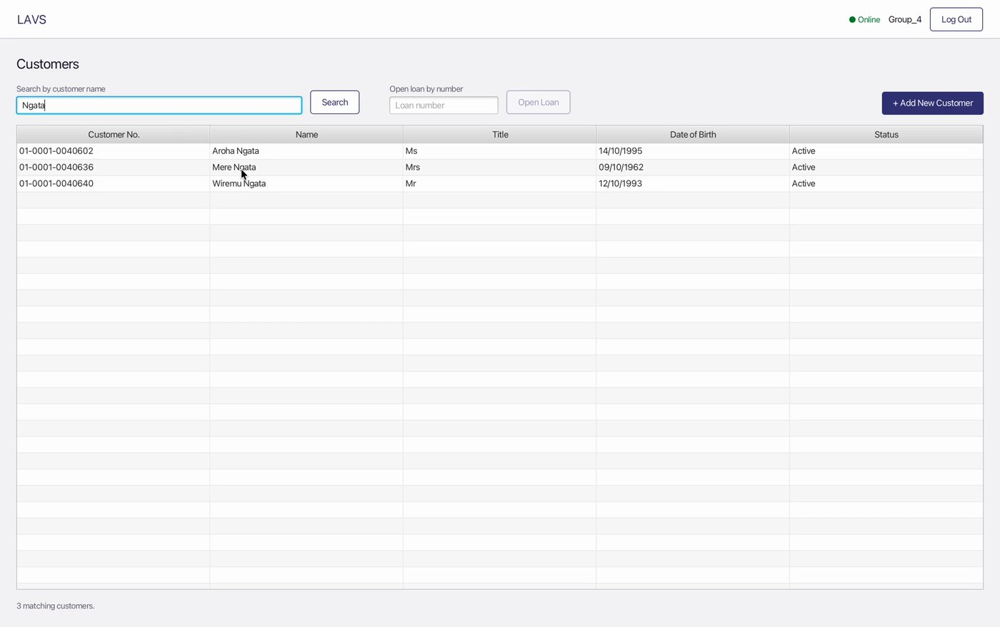
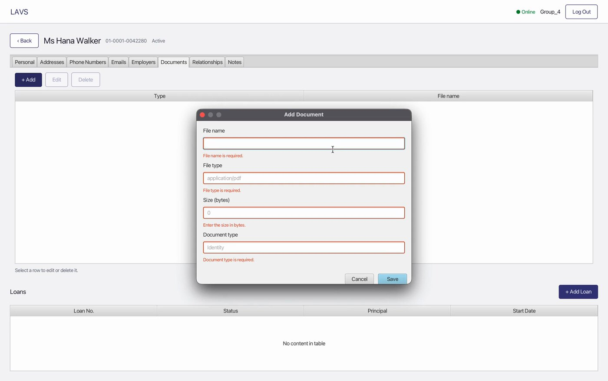
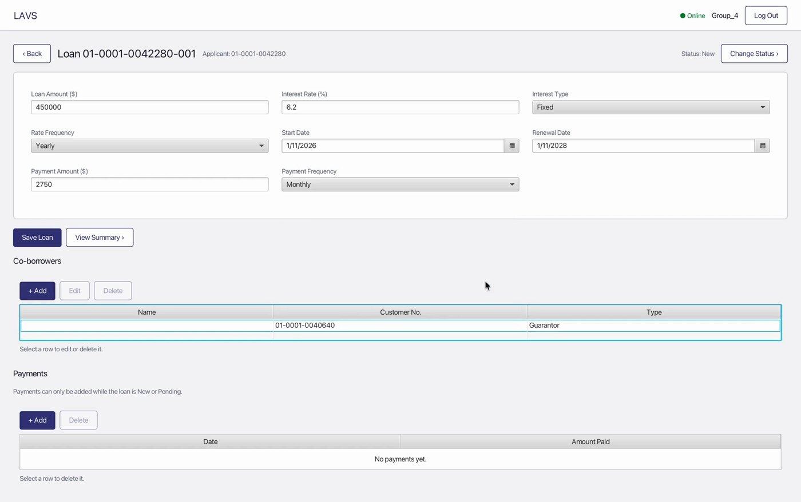
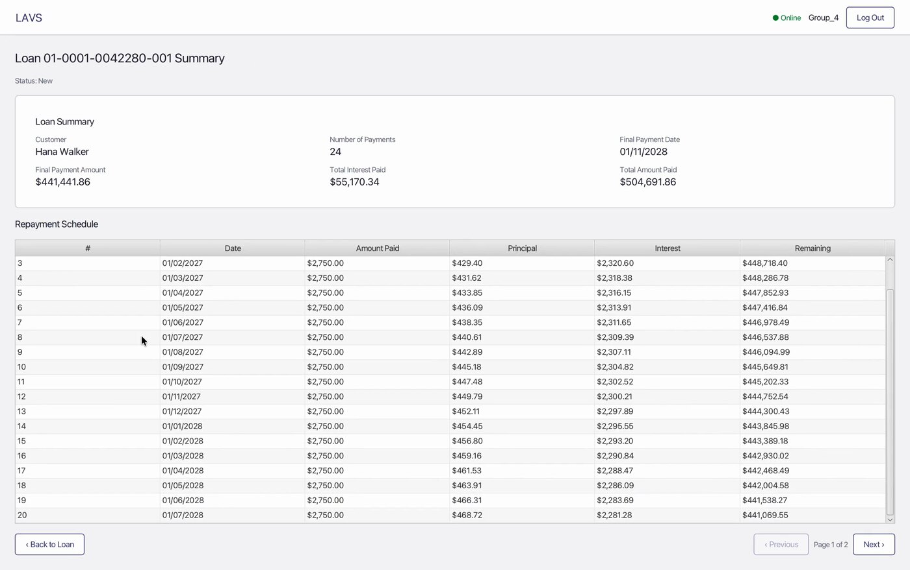

# LAVS — Loan Application and Verification System

A JavaFX desktop application that gives bank staff a clean, validated front end to a legacy loan mainframe. Built by a team of four for **SOFTENG 306 (Project 2)** at the University of Auckland, 2026.

> **Context.** The client in the course brief is a fictional bank, *Countrywide Banking Corporation*. Its Mobile Mortgage Managers take loan applications at customers' homes, but the only way into the mainframe is a 1980s terminal emulator: shortcut keys, one wrong character means re-entering a whole screen, and a dropped mobile connection loses the application. LAVS replaces that with a usable GUI that validates data before anything is sent and recovers from lost sessions.

## Demo

[](docs/demo/LAVS-demo.mp4)

A silent 4:11 walkthrough of the full loan process: log in, find a customer, add a relationship, create a new customer with live validation, add an address, phone number and note, record a document, create a loan, link a co-borrower and change them to a guarantor, view the repayment summary and schedule, add a payment, move the loan to Pending, and log out.

<!-- For inline playback on GitHub: edit this file on github.com, drag docs/demo/LAVS-demo.mp4 into the editor, and paste the generated user-attachments link on its own line here. -->

## Screenshots

| | |
|---|---|
| <br>Search for a customer by name, or open a loan by number | <br>Errors appear on the exact field before anything is sent |
| <br>Loan details with co-borrowers and payments | <br>Loan summary and paged repayment schedule |

## Features

**Required (all implemented)**
- Log in and log out
- Add, list, retrieve and edit customers
- Add, update and delete addresses, phone numbers, emails and employers
- Add and edit loans; retrieve a customer's loans, the full loan details, repayment summary and schedule
- Add, update and delete co-borrowers (including guarantors)
- Change a loan's status
- Retrieve constant values (dropdown categories) from the mainframe

**Optional components (one per team member)**
- Customer relationships
- Customer notes
- Customer documents (metadata only)
- Loan payments

**Behaviour worth noting**
- Customer-first flow: *Add Loan* stays disabled until the customer has a mailing address and a phone number or email, and says what is missing.
- Every call to the mainframe runs on a background worker, with a spinner and disabled buttons, so the window never freezes and nothing is saved twice.
- A lost session logs in again and retries the request once.
- Date fields use pick-only date pickers.

## Architecture

```
UI (JavaFX, FXML)      lavs.ui          Collects input, shows results, no business logic
        │
Services               lavs.service     Business rules and orchestration
  + validation         lavs.validation  Field validation and customer / loan rules
        │
Gateways (interfaces)  lavs.gateway     What the application needs from the mainframe
        │
Adapters               lavs.adapter     Map domain records to the supplied mainframe messages
        │
Mainframe client       mainframe.client Supplied by the course (HTTP connection and message classes)
```

`lavs.domain` holds the shared records. Services depend only on gateway interfaces, so all business logic is unit tested with fakes and mocks instead of the live server. Every operation returns an `OperationResult` that is a success, a rejection carrying the mainframe's reason, or *unavailable*, so the screen can always tell the user what happened.

## Validation and business rules

- **Customer:** title, first name, family name, nationality and date of birth are required; date of birth cannot be in the future.
- **Address:** line 1, city, country and type required; an "Other" type needs its description.
- **Email and phone:** email must look like an address; phone needs a country code such as `+64` and a valid number; both need a type.
- **Employer:** name, position, salary and type required; salary must be positive.
- **Loan:** amount and payment above zero, rate not negative, frequencies and both dates required, renewal after start.
- **Payment:** amount above zero, date required and not in the future.
- **Customer rules:** a customer needs a mailing address and a phone or email before a loan can start, and the last mailing address or last contact method cannot be deleted.
- **Loan status rules** (enforced in the service, not just the UI):

| Current status | Allowed next |
|---|---|
| New | Pending, Cancelled |
| Pending | Active, Cancelled, New |
| Active | Defaulted |
| Defaulted, Cancelled | None (final) |

A loan cannot move to Pending until its details are complete.

## Testing and quality

- **405 unit tests**, 0 failures (JUnit 5 and Mockito). None needs the live mainframe.
- **98.9% line coverage** of the business-logic packages (1,589 of 1,607 lines; 98.9% instructions, 96.3% branches), measured with JaCoCo. The course target was 95%.
- **349 methods, average cyclomatic complexity 1.82.** Five validator methods in `ValidationService` exceed a complexity of 10 (the highest is `validateLoan` at 23); each is a long list of simple independent checks.
- Figures are from the final build at submission (October 2026).

## Tech stack

Java 17 · JavaFX 17 (FXML) · Maven · JUnit 5 · Mockito 5 · JaCoCo

## Build, test and run

Requirements: JDK 17 or newer and Maven.

```bash
mvn clean compile
mvn test            # also writes the coverage report to target/site/jacoco/index.html
mvn javafx:run
```

`mvn test` skips the supplied live-server tests by default, because their results depend on shared server data, permissions and availability.

**Running the application needs the course's mock mainframe server and team-issued credentials, which are not included in this repository, and the server may no longer be reachable.** The demo video above shows the application running against it. To configure a connection, copy `.env.example` to `.env` (ignored by Git) and set:

| Variable | Purpose |
|---|---|
| `LAVS_MAINFRAME_USERNAME` / `LAVS_MAINFRAME_PASSWORD` | Team-issued mainframe login |
| `LAVS_BASE_URL` | Overrides the default course server URL |
| `LAVS_ORGANISATION_ID` | Leave as `0` to use the logged-in user's organisation |

## Team

| Member | GitHub | Main areas |
|---|---|---|
| Hargun Singh | [Hargun2005](https://github.com/Hargun2005) | Project setup, navigation and controller wiring, authentication, categories, connection monitoring and session recovery; optional: relationships |
| Rohit Balaji | [RohitB2005](https://github.com/RohitB2005) | JavaFX screens and the reusable list and dialog components; optional: notes |
| Jim Zhou | [FridgeProtector1](https://github.com/FridgeProtector1) | Domain model and mainframe adapters; optional: documents |
| Tanush Panuganti | [Goldengamer255](https://github.com/Goldengamer255) | Validation, business rules, repayment service, test coverage and JaCoCo setup; optional: payments |

## AI use

The course permitted AI for design, review, debugging and learning, and required students to write the core logic themselves. Each member kept a log of how they used AI (included in the team's project documentation), and code significantly influenced by AI is marked in the source with `// AI-assisted:` comments.

## Credits

- The `mainframe.client` package and the live-server tests in `src/test/java/mainframe` were supplied by the SOFTENG 306 teaching team.
- *Countrywide Banking Corporation* is a fictional client from the course brief.
- This repository is a copy of the team's coursework, kept here as a portfolio piece. No licence has been added.
